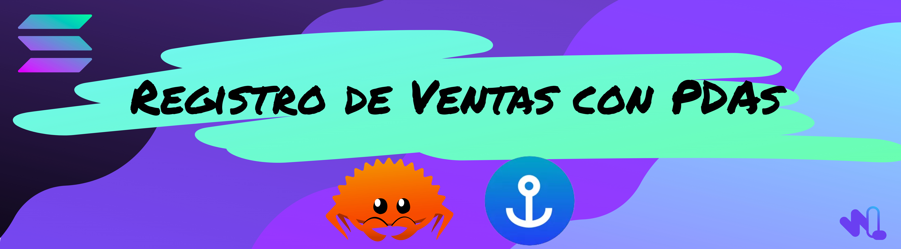
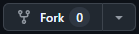
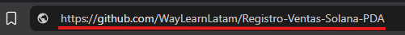
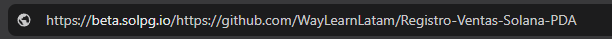
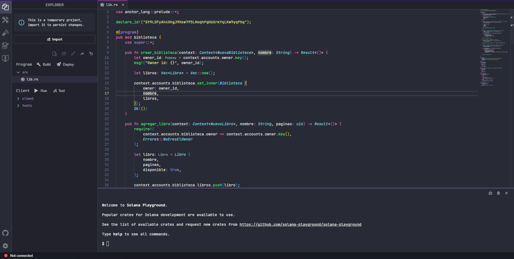
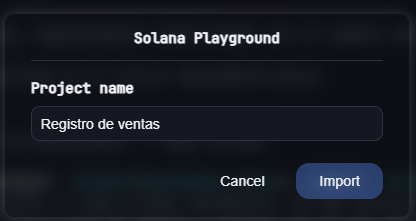
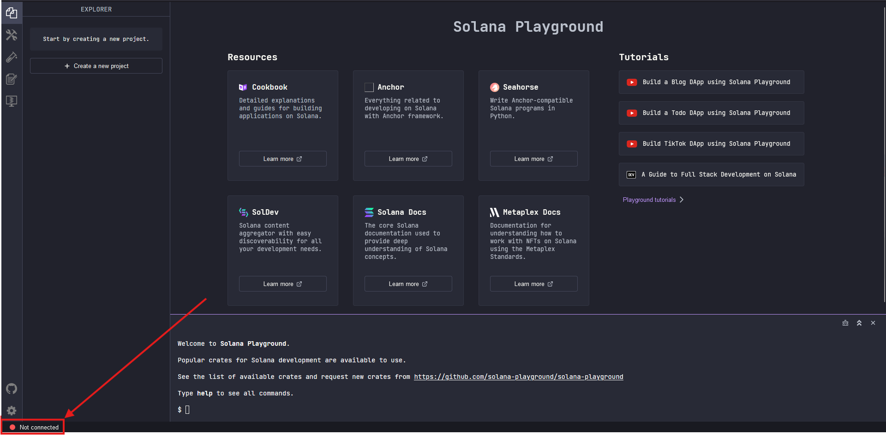
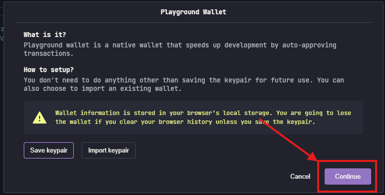
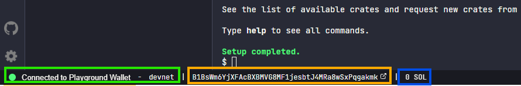

# Registro de Ventas en Solana con PDAs



> **Esta guía pertenece al proyecto backend original del bootcamp.** En este monorepo, el código actualizado está en [`backend/src/lib.rs`](./src/lib.rs): conserva las instrucciones V1 e incorpora Inventario V2 y la baja de clientes. El programa de esta versión ya está desplegado en Devnet con el Program ID `4dJoKhvY2XC6WpHv8b7RCHKsTfUpGpELiDjAjf4grcE3`. Para publicar cambios futuros, no importes y despliegues sin más el repositorio original enlazado abajo: primero asegúrate de que el repositorio importado contiene la versión actualizada. Consulta el [flujograma de despliegue del proyecto integrado](../flujograma.md) y el [README general](../README.md).

CRUD básico de un Solana Program desarrollado con Rust y Anchor desde el Solana Playground. 

Puedes comenzar dándole Fork a este repositorio (abajo te explicamos como 👇), **hemos preparado un entorno de codespaces listo para que no tengas que instalar nada**, solo déjate llevar por la fluidez de los ejercicios y temas desarrollados especialmente para ti. 

Asegúrate de clonar este repositorio a tu cuenta usando el botón **`Fork`**.



## Importando el proyecto 

Ya con el repositorio en tu cuenta lo siguiente que debes hacer copiar el `enlace de tu repositorio`, lo que se puede hacer directamente desdel navegador:



Posteriormente, lo uniremos con el siguiente enlace en nuestro navegador de preferencia:

```url
https://beta.solpg.io/
```

Lo que nos dará algo parecido a:



Puedes importar directamenet el proyecto al `Solana Playground` dando clic al siguiente enlace 👇:

[ 🔗 Importar repositorio al Playground ](https://beta.solpg.io/https://github.com/WayLearnLatam/Registro-Ventas-Solana-PDA)

Al pulsar enter seremos enviados al `Solana Playground` con nuestro proyecto abierto:



Para guardarlo solo damos clic en el boton `import` y asignamos un nombre:



## Preparacion del entorno

Primero conectaremos el entorno con la devnet, lo que tambien procederá a la creación de una wallet. Para eso daremos clic en donde dice **Not Conected**:



Saldrá la siguiente ventana donde daremos en el botón **Continue**:



Como resultado se mostrará la siguiente información:



* En verde: el estado de la conexión y el entorno al que se encuentra conectado

* En amarillo: la la dirección de la wallet conectada

* En azul: la cantidad de tokens en la wallet

> ℹ️ ¿Quieres ver el ejemplo de un "Hola Mundo" en Solana?. Da clic aquí: 👉 [Ver Ejemplo](https://github.com/WayLearnLatam/Solana-starter-kit/tree/1fc6349ba63375a3fe223d8d56911bc64765459b/build-deploy)

