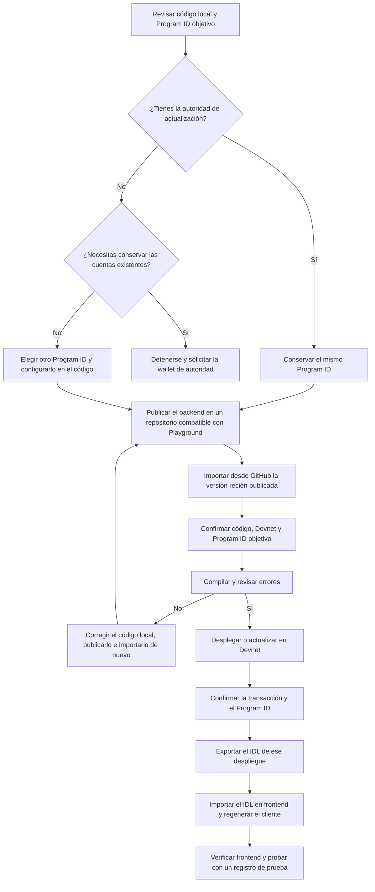

# Flujograma de despliegue: backend y frontend

Esta guía describe cómo desplegar en **Devnet** el backend actualizado de RegistroVentas y conectar el frontend al mismo programa. Incluye Inventario V2 y la instrucción `eliminar_cliente`.

> **Estado (22 de noviembre de 2026):** el upgrade del Program ID `4dJoKhvY2XC6WpHv8b7RCHKsTfUpGpELiDjAjf4grcE3` se confirmó en Devnet, slot `525118972`, mediante la [transacción de actualización](https://explorer.solana.com/tx/4T8A3SgWeFvtgYSgQZaRha2BpJj7zDHhhdYt7JqL7gmdWAhigaMc9yV9ooPj1WiKGqNhvr8HxYrAMNzsaqabwNe2?cluster=devnet). Se reportó una inicialización exitosa de Inventario V2 desde el frontend; el resto de recorridos V2 aún requiere pruebas manuales. Esta guía describe el flujo para futuras actualizaciones.

## Diagrama de decisiones



## 1. Antes de abrir Solana Playground

1. Guarda los cambios del proyecto y revisa que el backend que vas a desplegar sea el actualizado:
   - `backend/src/lib.rs` conserva V1, agrega Inventario V2 e incluye `eliminar_cliente`.
   - No uses una copia antigua del programa por error.
2. Compara el Program ID definido por el código local con el programa que quieres actualizar:
   - El código actual declara `4dJoKhvY2XC6WpHv8b7RCHKsTfUpGpELiDjAjf4grcE3`.
   - El frontend local también está configurado con ese Program ID en `frontend/src/config/programa.json`.
   - Confirma en Solana Explorer/Playground que ese es el programa de **Devnet** que pretendes actualizar. No asumas que una coincidencia local demuestra que el programa ya tiene el código nuevo.
3. Identifica la **autoridad de actualización** del programa. La wallet que registra ventas desde el frontend puede ser distinta de la wallet que tiene permiso para actualizar el programa.
4. Prepara una wallet de práctica en Devnet con SOL suficiente para la actualización/despliegue y las pruebas. No uses Mainnet ni compartas frases de recuperación, claves privadas o archivos keypair.

### Decisión importante: actualizar o desplegar un programa nuevo

- **Actualizar el mismo Program ID:** conserva las direcciones derivadas de las cuentas existentes, siempre que se mantengan las mismas seeds y formatos V1. Solo se puede hacer si firmas con la autoridad de actualización correcta.
- **Desplegar con un Program ID nuevo:** el despliegue anterior y sus cuentas permanecen en la cadena, pero el nuevo programa deriva otro espacio de PDAs. El frontend no verá automáticamente los registros antiguos; para probar el nuevo programa hay que configurar el nuevo IDL/Program ID y crear un registro nuevo.
- Si necesitas mantener los datos existentes y no tienes la autoridad, **detente** y solicita acceso a quien administra el programa. No intentes reemplazarlo ni cambies el ID pensando que eso actualizará sus cuentas.

## 2. Publicar el backend actualizado en GitHub

Para el flujo basado en GitHub, este paso va **antes** de importar el proyecto en Solana Playground. Playground importa una copia del repositorio; no ejecuta ni sincroniza automáticamente los archivos locales de `RegistroVentas/`.

1. Identifica el repositorio remoto que vas a importar. Debe ser un proyecto standalone de Anchor compatible con Playground, con los archivos del programa en la raíz esperada por la plataforma.
2. El monorepo `RegistroVentas/` no debe importarse desde su raíz como si fuera ese proyecto standalone. Además, el enlace del README de `backend/` apunta al repositorio original de clase: **no contiene automáticamente** los cambios locales.
3. En tu repositorio/fork standalone del backend, actualiza el archivo de programa (`src/lib.rs`) con el contenido actual de `backend/src/lib.rs`. Conserva los archivos de configuración requeridos por ese proyecto; no reemplaces su configuración de Anchor sin necesidad.
4. Antes de publicar, confirma que el código contiene las instrucciones de Inventario V2 y `eliminar_cliente`. Si actualizas, `declare_id!` debe conservar el Program ID existente; si elegiste otro ID, configúralo en el código antes de publicarlo.
5. Publica esos cambios en GitHub (commit y push). No publiques wallets, keypairs, frases de recuperación ni claves privadas.
6. Guarda la URL/commit publicado. Esa será la fuente que cargarás en Playground. Si corriges el backend después, vuelve a publicar los cambios y reimporta/actualiza el proyecto de Playground; no basta con guardar solo los archivos locales.

> **Alternativa:** puedes copiar manualmente `backend/src/lib.rs` al editor de Playground, pero eso no importa el archivo local de manera automática ni sincroniza GitHub. Si eliges esa alternativa, conserva una copia del proyecto y revisa cuidadosamente que pegaste la versión más reciente. El resto de esta guía sigue aplicando.

## 3. Importar el repositorio publicado en Solana Playground

1. Abre [Solana Playground](https://beta.solpg.io/).
2. Importa la URL de tu repositorio standalone actualizado, no el monorepo completo ni la versión original sin tus cambios. La URL de importación sigue el formato 
`https://beta.solpg.io/https://github.com/mcabanillassalas/RegistroVentas/tree/main/backend`

3. Guarda el proyecto importado con un nombre que identifique la versión. No sobrescribas la única copia del proyecto anterior.
4. Comprueba en el editor que `src/lib.rs` es el contenido recién publicado y que incluye `eliminar_cliente` y las instrucciones de Inventario V2.
5. Conecta en Playground la wallet que corresponde a la autoridad de actualización y selecciona **Devnet**. Revisa la dirección de la wallet conectada antes de firmar.
6. Conserva el Program ID actual si vas a actualizar el programa existente. Verifica que `declare_id!` y la configuración/key del programa en Playground correspondan al Program ID elegido. No generes uno nuevo accidentalmente.
7. El Program ID de la fuente importada debe coincidir con la decisión tomada antes de publicar. Si no coincide, no compiles ni despliegues: actualiza el código local, publícalo e importa esa versión.
8. Si Playground permite introducir un Program ID personalizado, aplícalo con **Change program ID** y confirma que muestre **Updated program ID** junto al ID esperado. Ver el texto en el campo, por sí solo, no acredita que ese sea el destino del upgrade.

> Si Playground muestra errores de dependencia o de versión de Anchor, no cambies versiones al azar. Comprueba el `Cargo.toml` del proyecto Playground y resuelve la compatibilidad con el toolchain de ese entorno antes de desplegar.

## 4. Compilar y desplegar el backend

1. Ejecuta **Build/Compile** en Playground.
2. Si la compilación falla, no pulses Deploy. Lee el primer error, comprueba que copiaste el archivo correcto y corrige la incompatibilidad en el proyecto Playground. Vuelve a compilar.
3. Cuando la compilación termine correctamente, verifica otra vez:
   - la red es Devnet;
   - el Program ID es el esperado;
   - la wallet es la autoridad correcta si se trata de una actualización.
4. Ejecuta **Upgrade** al actualizar el programa existente (o **Deploy** solo si vas a crear un programa nuevo) y revisa la transacción en la wallet.
5. Espera la confirmación y guarda la firma. La transacción debe indicar que actualizó el Program ID esperado; el mensaje final de Playground no basta.
6. Abre el Program ID/ProgramData en Explorer con el clúster **Devnet** y confirma que el slot de despliegue avanzó. Si el despliegue falla por falta de autoridad o apunta a otro ID, no sigas ni cambies a un programa nuevo sin decidir qué ocurrirá con las cuentas existentes.

## 5. Exportar el IDL del programa desplegado

1. Desde Playground, exporta el IDL generado para el programa que acabas de desplegar. No uses el IDL manual que ya venía en el frontend ni un IDL exportado antes de esta compilación.
2. Guárdalo temporalmente dentro del frontend, por ejemplo como:

   ```text
   frontend/tmp-idl/registro.json
   ```

   `tmp-idl/` está excluido del control de versiones.
3. Abre el archivo y comprueba que corresponde al Program ID desplegado y que incluye:
   - las instrucciones V1 que conserva la app;
   - las cuentas e instrucciones de Inventario V2;
   - `eliminarCliente` y sus cuentas/argumento;
   - los errores de cliente con ventas y cliente no registrado.
4. Si el IDL exportado no incluye estas instrucciones, no continúes con el frontend: probablemente se compiló o desplegó una copia antigua del backend.

## 6. Conectar el frontend al mismo despliegue

Abre PowerShell en la carpeta del frontend:

```powershell
cd D:\DevWayLearn\proyecto-final\RegistroVentas\frontend
```

Si el servidor de desarrollo ya está ejecutándose, detenlo con `Ctrl+C` antes de importar el IDL; vuelve a iniciarlo después de regenerar el cliente.

Si todavía no instalaste las dependencias en este equipo:

```powershell
npm ci
```

Importa el IDL exportado. Si el JSON incluye su dirección del programa:

```powershell
npm run configurar:idl -- .\tmp-idl\registro.json
```

Si el IDL no contiene una dirección, indícala explícitamente. Sustituye el ejemplo por el Program ID que efectivamente desplegaste:

```powershell
npm run configurar:idl -- .\tmp-idl\registro.json --program-id 4dJoKhvY2XC6WpHv8b7RCHKsTfUpGpELiDjAjf4grcE3
```

El script respalda el IDL local anterior en `frontend/.aula/respaldos/`, valida el contrato y genera el cliente. Comprueba que:

1. `frontend/idl.json` contiene el IDL exportado.
2. `frontend/src/config/programa.json` tiene el mismo Program ID y no marca el programa como referencia.
3. `frontend/clients/js/src/generated/` fue regenerado y exporta las instrucciones nuevas.
4. No editaste manualmente el código generado. Si necesitas regenerarlo sin volver a importar, ejecuta:

   ```powershell
   npm run cliente
   ```

Luego verifica todo el frontend:

```powershell
npm run verificar
```

Este comando comprueba TypeScript, pruebas automatizadas, coherencia entre IDL/Program ID/cliente y el build de producción. Si el importador rechaza el IDL por una instrucción, tipo o campo faltante, detente y confirma que exportaste el IDL del binario correcto; no elimines validaciones para forzar la importación.

## 7. Ejecutar y probar desde el frontend

1. Inicia la aplicación desde `frontend/`:

   ```powershell
   npm run dev
   ```

2. Abre la URL local en una pestaña normal del navegador con la wallet de práctica instalada.
3. Confirma que la app indica **Devnet verificada** y que no muestra el aviso de programa de referencia.
4. La wallet del navegador debe tener SOL de prueba. Para escribir en un registro existente, su dirección debe ser la autoridad de ese registro; no basta con que sea la autoridad de actualización del programa.
5. Si desplegaste un **Program ID nuevo**, crea un registro de prueba nuevo desde esta app. No esperes que aparezcan las cuentas del programa anterior.
6. Prueba primero con datos de práctica:
   - consulta o crea el registro y crea un cliente;
   - en inventario, inicializa el inventario, crea un producto con existencias, reabastécelo y registra una venta V2;
   - ajusta y devuelve la venta; comprueba el historial y el stock;
   - crea un cliente **solo para esta prueba**, sin ventas, y usa **Dar de baja**. Confirma la ventana de baja, firma en la wallet y revisa que la transacción esté confirmada y el cliente ya no aparezca;
   - prueba la protección con un cliente de prueba que sí tenga venta activa. La instrucción debe rechazar la baja. No uses un cliente real o importante para esta prueba: la baja exitosa es irreversible.
7. Abre cada firma en Solana Explorer con `cluster=devnet`. Comprueba el resultado de la transacción; la firma solicitada no basta para afirmar que se ejecutó correctamente.

### Si el frontend está publicado en un hosting

Después de importar el IDL y completar `npm run verificar`, genera el build de producción y publica el contenido de `frontend/dist/` mediante el flujo de tu hosting. Cada proveedor tiene su propio proceso; configura el directorio publicado como `dist` y conserva el RPC de Devnet. El frontend debe volver a compilarse/publicarse cuando cambie el IDL, el Program ID o el código de la interfaz. Publicar el frontend no despliega ni actualiza el programa on-chain.

## 8. Qué conservar como evidencia y qué no compartir

Registra de forma segura:

- Program ID y red;
- fecha del despliegue/actualización;
- firma pública de despliegue;
- resultado de `npm run verificar`;
- firmas y resultados de las pruebas manuales que hayan confirmado;
- resultado esperado/observado de los casos rechazados.

El Program ID, el IDL y las firmas son datos públicos. **No** publiques frases de recuperación, claves privadas, archivos de wallet/keypair ni archivos de configuración con secretos. No agregues `frontend/tmp-idl/` ni respaldos temporales al control de versiones.

## Solución rápida de problemas

| Síntoma | Qué revisar |
| --- | --- |
| Playground compila, pero el IDL no tiene `eliminarCliente` o Inventario V2 | Se compiló una copia antigua; vuelve a cargar `backend/src/lib.rs`, compila y despliega esa versión. |
| `system_program` no está declarado o `AccountInfo` no tiene `resize` | Usa el código actualizado de `backend/src/lib.rs`: importa `anchor_lang::system_program` y cierra el historial con `realloc(0, false)`. Publica la corrección en el repo standalone y vuelve a importarlo antes de compilar. |
| Airdrop automático falla con RPC error 410 | El faucet automático de Playground está cerrado. Solicita SOL de Devnet en [faucet.solana.com](https://faucet.solana.com/) para la wallet conectada a Playground. Para dejar de ver el intento automático, ejecuta en su terminal `setting set wallet.automaticAirdrop false`. |
| El despliegue rechaza la firma por autoridad | La wallet conectada no es la autoridad de actualización. Para conservar el Program ID/datos existentes, solicita la wallet correcta. |
| El Program ID de `programa.json` no coincide con Playground | Reimporta el IDL del programa desplegado y regenera el cliente antes de iniciar la app. |
| La app muestra el programa de referencia o bloquea consultas | El IDL no se importó correctamente; revisa `idl.json`, `programa.json` y ejecuta `npm run comprobar:idl`. |
| Una transacción falla después de importar | Confirma el clúster, Program ID, autoridad del registro, saldo Devnet y que el IDL provenga del mismo código desplegado. |
| La baja falla por ventas activas | Devuelve/cierra primero las ventas V1 y V2 activas; la validación del backend es intencional. |
| Tras desplegar un Program ID nuevo no aparecen registros previos | Es esperado: las PDAs derivan del Program ID y los datos anteriores no se migran automáticamente. |
